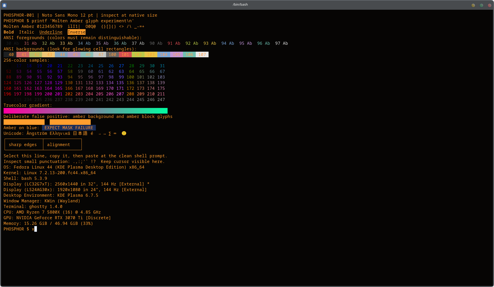
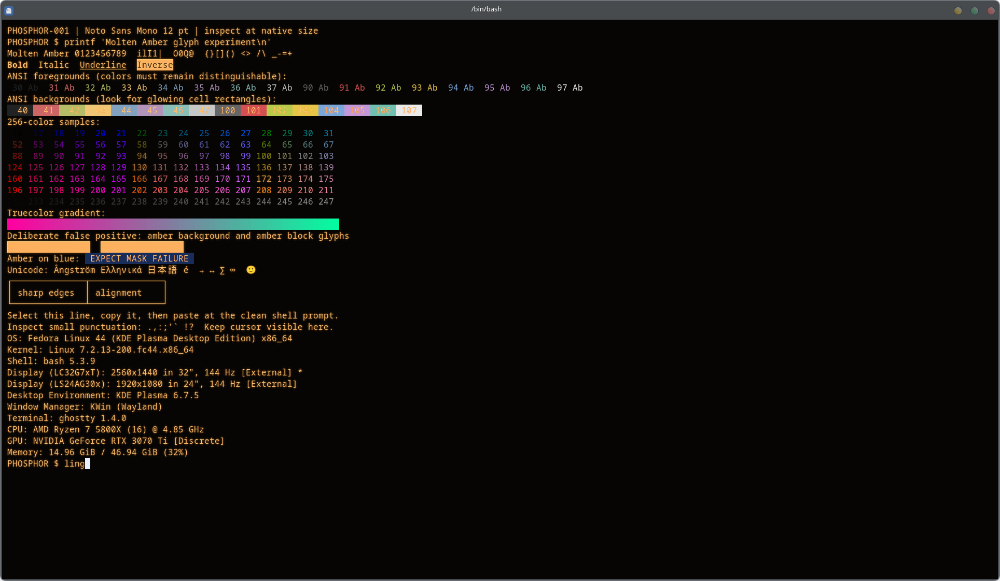

# PHOSPHOR-001 — native Ghostty feasibility result

**Recommendation: NO-GO for the tested config-only post-processing approach
as PHOSPHOR's visual foundation.** At normal 12 pt, the real application adds
an outline/halo but does not reproduce the approved metallic glyph surfaces.
Amber cell backgrounds receive the same material treatment as glyphs, and
native chrome remains ordinary. These are material gaps against the approved
concept, not grounds to lower its acceptance criteria.

This recommendation applies to this experiment and the composited-frame API.
It is not proof that every possible shader is incapable of any metallic effect,
or that a separately authorized glyph-aware Ghostty modification cannot work.
No such renderer modification has been implemented or validated. The owner
decides the gate. No full product work, merge, issue closure or release follows
from this report.

## What ran

On 2026-11-01, following owner approval, Ghostty 1.4.0 was built from its
verified, signed upstream source tarball with Zig 0.17.0. Refreshed official
Fedora repositories had no Ghostty package. Headers/libraries were extracted
locally from verified Fedora RPMs; no package was installed and no privilege
was used. See [build provenance and commands](BUILD.md).

Native tests used Fedora 44, KDE Plasma 6.7.5, Wayland, NVIDIA RTX 3070 Ti
(8192 MiB), driver 615.78.08, scale 1 and standard Noto Sans Mono at 12 pt.
Logs confirm NVIDIA EGL, OpenGL 4.3 and successful shader loading. Baseline and
prototype share a configuration; prototype adds only the custom shader.

The active physical displays remained 1080p/1440p at approximately 144 Hz.
The 4K test uses an **oversized native Wayland window with a verified
3840×2160 client/buffer**, partly clipped by those displays. This exercises
actual 4K buffer rendering on the target GPU, but **does not verify physical
4K presentation, refresh, fractional scaling, or full-screen 4K readability**.
No display modes, Konsole profiles, default terminal or system terminal settings
were changed.

## Real visual evidence

These are original, unedited Spectacle captures of the running application,
including native decorations. They are not generated mockups or processed
comparison composites. Open the originals at 100%; scaled thumbnails obscure
the already small effect.

| Approved Molten Amber concept | Actual baseline, effects off | Actual prototype, effects on |
| --- | --- | --- |
|  |  |  |

The alternate [approved amber concept](../../ChatGPT%20Image%20Nov%201,%202026,%2004_25_52%20PM-1.png)
is also preserved. All five original artwork hashes still match the
[original manifest](evidence/artwork.sha256).

The 1080p client captures are 1928×1122 including frame decorations. Full
[baseline 4K-buffer](evidence/native/screenshots/baseline-4k-buffer-final.png)
and [prototype 4K-buffer](evidence/native/screenshots/prototype-4k-buffer-final.png)
captures are 3848×2202 including decorations. Adjacent geometry JSON records
show the exact client/buffer sizes. The font is not enlarged for these shots.

| Requirement | Native observation | Assessment |
| --- | --- | --- |
| Distinct metallic cores and glyph surfaces | Small edge highlights and halos; no convincing material depth or per-character faceting at 12 pt. The block-character strip remains a flat rectangle. | Does not meet the reference. |
| Thin contours, controlled glow, crisp reading | Contours/halos are visible in the original prototype capture, but soften punctuation and double the apparent outline of box drawing. Large empty areas stay dark. | Some effect exists; fidelity/readability tradeoff remains. |
| Text-specific material | The deliberately matching amber background strip is brightened like the solid-block glyph strip. Amber text on blue is treated differently; many other colors bypass the heuristic. | Semantic false positives; not a generally correct glyph material. |
| ANSI/truecolor and Unicode | Sample colors remain varied; Japanese fallback, combining text, emoji and boxes render. Colors near the amber heuristic can be changed; preservation is not universal. | Visible smoke coverage, not full conformance. |
| Cursor and selection | The trial deliberately uses a white cursor and blue selection. | These controls do not satisfy the approved amber treatment. Interaction findings are recorded separately below. |
| Native geometry and chrome | Normal rectangular KDE-decorated window. Buttons, borders and controls have no concept-style illumination. | Geometry retained; chrome requirement unsolved separately. |

The key source limitation remains the one identified in
[the preserved Phase 0 report](PHASE0_REPORT.md): the custom shader receives
the already-composited terminal image, without a glyph atlas/mask, selection
geometry or per-character material coordinates. Identical amber pixels can
have different semantic origins. The native background/block-strip experiment
exposes that ambiguity directly.

## Performance and terminal checks

The [validation tools](tools/README.md) run each mode separately, with three
repetitions per client size and alternating mode order, a 10-second warmup,
then 30 one-second idle samples and 30 scrolling samples. Scroll emits 32 lines
per approximately 1/60 second. The shader is static and custom shader animation
is disabled. CPU is the Ghostty process only, expressed as percent of one
logical core; it excludes the workload process. GPU readings cover the entire
GPU and include the compositor and other applications.

| Client buffer | Mode | Workload | Samples | Mean CPU, one core | Median whole-GPU utilization |
| --- | --- | --- | ---: | ---: | ---: |
| 1920x1080 | baseline | idle | 90 | 0.31% | 23.0% |
| 1920x1080 | baseline | scroll | 90 | 14.03% | 28.0% |
| 1920x1080 | prototype | idle | 90 | 0.60% | 23.5% |
| 1920x1080 | prototype | scroll | 90 | 16.23% | 31.0% |
| 3840x2160 | baseline | idle | 90 | 0.48% | 21.0% |
| 3840x2160 | baseline | scroll | 90 | 19.03% | 33.0% |
| 3840x2160 | prototype | idle | 90 | 0.70% | 29.0% |
| 3840x2160 | prototype | scroll | 90 | 25.41% | 34.0% |

All 12 runs exited successfully and recorded 720 samples. Raw data and per-run
geometry/logs are preserved in [measurements](evidence/native/measurements/).

These observations do not provide per-process GPU timings, frame-presentation
rates, dropped-frame counts, physical 4K acceptance or key-to-pixel latency.
Other desktop activity and GPU power-state changes confound the GPU/power
figures. No performance acceptance threshold was invented for the owner.
Successful throughput does not compensate for failed visual fidelity.

**Owner stop, 2026-11-01:** further testing was stopped on request. All
disposable test windows were closed. Static text, fastfetch, color/Unicode
fixtures, resizing between capture sizes, and rapid output were exercised in
the native application. Automated keyboard injection was attempted but did not
produce a verified result. Native selection/copy-paste, cursor-style/visibility
transitions, a native fullscreen TUI, and key-to-pixel latency remain unverified.
The earlier pseudo-terminal curses check is not a native TUI validation.
No full implementation or further phase was started.

## Corrections made during the experiment

- Native testing exposed an early Ghostty template write before the CLI
  `config-default-files=false` flag took effect. The launcher now uses a private
  temporary XDG config directory and cleans it on exit. The known new template
  from preflight was preserved then removed; existing user config was not
  overwritten. A regression check covers this path.
- The initial `alpha-blending=native` setting produced a lifted background:
  captured RGB `(42,38,34)` rather than configured `(6,5,4)`. The final trial uses
  Ghostty's Linux-default `linear-corrected` pipeline and linear material colors.
  Both final baseline and prototype preserve `(6,5,4)` in empty areas. Old
  captures and interrupted diagnostic sampling are retained under
  `evidence/native/preflight/`, excluded from final comparisons/measurements.
- The benchmark originally lacked a visible mode label. After the owner
  pointed out the open console had no effect, the active run was verified to
  be the effects-off baseline and its title labeled. Subsequent runs label
  baseline/prototype in the title before warmup. Workload content and cadence
  were unchanged. The small effect in the saved prototype was not presented
  as a visual pass.

The [original Phase 0 validation record](evidence/validation.txt) and report
are retained as historical evidence. New native logs, original screenshots,
raw samples, source/config hashes and build provenance accompany this report.

## Owner review

Reject this post-process-only prototype as meeting the approved PHOSPHOR
appearance. Keep Ghostty's existing terminal functionality as a possible
foundation only if the owner separately authorizes a bounded glyph-aware
renderer feasibility issue. Such work would need a demonstrated glyph mask /
material-coordinate path, separate selection/cursor handling, its own cost and
maintenance assessment, and another native visual/performance gate.

This PR does not authorize that work or a full application. The owner retains
merge and phase decisions; issue #1 is not closed automatically.
