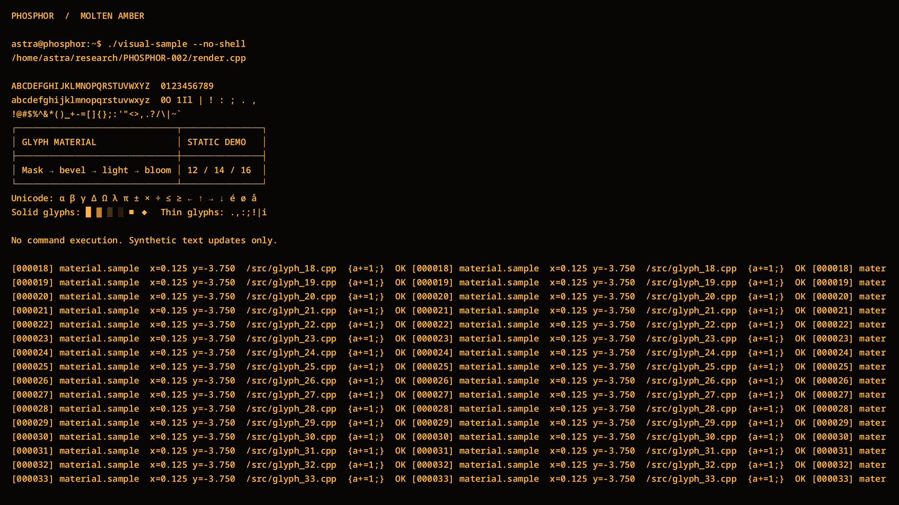
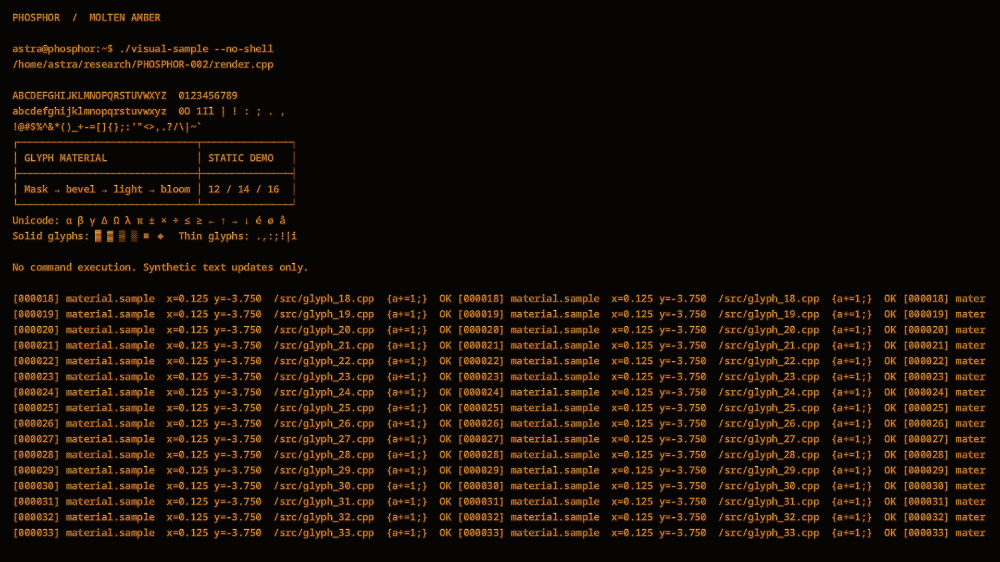
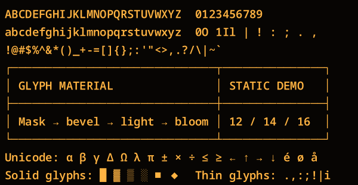
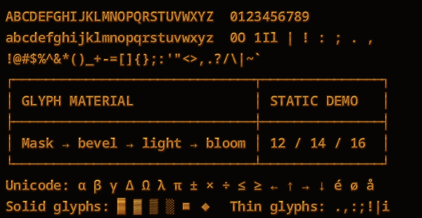

# PHOSPHOR-002 — Qt molten-glyph feasibility result

**Recommendation: NO-GO for advancing this tested renderer into full PHOSPHOR
development. Owner aesthetic review remains decisive.**

This is a genuine glyph-aware material experiment: directional bevel lighting,
interior reflection bands and a thin emissive rim are calculated from font masks
before compositing, independently of bloom. It fixes the earlier semantic
ambiguity of recoloring already-composited backgrounds. However, at everyday
12–16 pt sizes the result still reads predominantly as amber outlined/glowing
text. It does not convincingly reproduce the concept's molten-metal surfaces.
A functioning Qt window and nonuniform glyph colors are not sufficient to pass
the visual gate.

The whole-image CPU paint/upload path also costs too much for dense 4K updates,
and the optimized local GCC build discrepancy is unresolved. These are not
narrowly demonstrated corrections with a bounded path to aesthetic acceptance,
so **CONDITIONAL GO would overstate the evidence**. This result does not prove
that Qt Quick or every possible glyph material is incapable of the target.
No full application, terminal engine, other theme, merge, issue closure or
release follows from this investigation.

## What was implemented

[Source and run instructions](../../prototypes/qt-molten-amber/README.md): C++20,
Qt 6 Quick, a normal standalone resizable Wayland window and a reusable CPU
glyph-material cache. The only content is a deterministic monospaced fixture
and optional synthetic bulk text updates. There is no shell, PTY, command
execution, terminal parser, settings system or production chrome.

[Phase 0 / architecture](PHASE0.md) explains mask → signed distance → bevel
normal/reflection → rim/glow → cached glyph → Qt Quick texture presentation.
Effects-off uses the same font, mask, grid positions and sampling. The title is
ordinary sample text at the same point size. No artwork is loaded by the app.

The approved artwork and prior PHOSPHOR-001 evidence remain byte-for-byte
unchanged. The branch starts from accepted main `3adc5a4` (merged PR #2).
[Build provenance](BUILD.md) includes local-only dependencies, reproduction,
cleanup and compiler diagnostics. Proposed original-source license: MIT for
owner decision; no license or artwork rights were silently changed.

## Unedited application evidence and approved references

Full captures are unmodified PNGs from the running native app. `*-client.png`
is QQuickWindow's live framebuffer; `*-native.png` is Spectacle's compositor
capture. Both are preserved with logs and geometry JSON. Open original files
at 100% to evaluate text; thumbnails downscale it.

| Approved Molten Amber | Actual 14 pt baseline | Actual 14 pt material |
| --- | --- | --- |
|  |  |  |

The [alternate approved amber artwork](../../ChatGPT%20Image%20Nov%201,%202026,%2004_25_52%20PM-1.png)
is also unchanged. Its apparent 4K label is part of the artwork, not a measured
font-size reference. No claim of exact font/physical-scale equivalence to an
AI concept image is made.

The following are **pixel-exact crops only**, no resampling, sharpening,
retouching or color adjustment: rectangle `(16,160)-(616,470)` of the respective
1920×1080 live client capture, displayed at their natural 600×310 pixel size.
They supplement, rather than replace, the unedited originals.

Baseline, 100% pixels:

Glyph material, 100% pixels:

Additional evidence:

- [12 pt baseline](evidence/native/12pt-baseline-native.png) / [12 pt material](evidence/native/12pt-material-native.png), including normal native decorations.
- [16 pt baseline](evidence/native/16pt-baseline-native.png) / [16 pt material](evidence/native/16pt-material-native.png).
- [Material with glow disabled](evidence/native/no-glow-client.png): interior/edge material remains, so this is more than adding bloom to a palette.
- [Physical 4K baseline](evidence/native/physical-4k-idle-baseline-native.png) / [physical 4K material](evidence/native/physical-4k-idle-material-native.png).
- [Process-local DPR 1.5 after resizing](evidence/native/resize-dpr1_5-client.png), with [geometry](evidence/native/resize-dpr1_5-geometry.json).

## Candid concept comparison

| Dimension | Observation | Gate assessment |
| --- | --- | --- |
| Letter shape | Standard Noto Sans Mono DemiBold. Fixed advances match between modes. The concept has smoother, more sculpted surfaces and different letter/icon forms. | Font and material shape do not match the design. |
| Material depth | Reflections and directional bevel are clearest on solid blocks and thicker stems; at small punctuation and ordinary thin strokes there is little interior area. | Computed material is real; convincing molten depth is not established. |
| Illuminated outline | Fine warm rim remains close to actual glyph coverage. | Weaker/less crisp than the artwork; brighter edges compete with dark interior detail. |
| Bloom | Finite local halo, controllable independently; empty background remains dark. | Does not reproduce the rich luminous metal of the reference. Increasing glow alone would not solve depth. |
| Readability | Latin letters, digits, punctuation and chosen BMP Unicode remain recognizable. 0/O and 1/I/l are explicitly included. | Baseline is more uniform. Material introduces contrast variation and softness; smallest marks have little remaining detail. No accessibility/user study. |
| Grid/boxes | Fixed cell advance aligns columns; Unicode boxes occupy the intended grid. | Visible small seams/highlight dots at cell joins; no terminal shaping/wide-character claim. |
| UI/chrome | Normal rectangular Qt/KDE window; normal title bar in windowed captures. | No illuminated concept border, toolbar/icons or controls. Those are intentionally outside this isolated renderer. |
| Background specificity | Material is generated from glyph coverage; no matching-color-background heuristic exists. No rectangular glow in final Clang captures. | Semantic isolation demonstrated; early failed GCC captures are diagnostics, not accepted output. |

## Presentation and focused validation

Test platform: Fedora 44, KDE/Wayland, Qt 6.11.2, Clang 20 release build, NVIDIA
RTX 3070 Ti 8 GiB / driver 615.78.08. Logs identify Qt Quick's **OpenGL QRhi,
basic render loop**; the final native smoke log confirms NVIDIA OpenGL ES 3.2. Noto Sans Mono DemiBold, default 14 pt, logical DPI 96;
12/16 pt pairs are also captured. Main physical tests use monitor scale 1.

1080p is fullscreen on DP-2 at 1920×1080 / approximately 144 Hz. Physical 4K
is fullscreen on the temporarily enabled independent HDMI-A-1 at
3840×2160 / 30 Hz, scale 1. Qt's screen and capture dimensions and KWin's
client/buffer geometry agree at 3840×2160. This is **not an offscreen or oversized
4K buffer on a smaller monitor**. It does not establish 60/144 Hz 4K performance,
HDR, calibrated color, viewing-distance readability or the owner's physical
perception of the display. The owner authorized the temporary HDMI change;
its prior mirror/mode/position/disabled state was restored and recorded.

The DPR 1.5 test uses `QT_SCALE_FACTOR=1.5`, not a desktop scale change. It
exercises the same native window at 800×600 then 1280×900 logical sizes, with
DPR-specific cache rebuilding. The DPR run accumulated about 15.5 seconds of
paint wall time across five paints/cache rebuilds, demonstrating visible cold
cache stalls. Its linked client capture/geometry precedes an extra helper-driven
window move/resize used for the separate native capture. Unit tests additionally cover DPR 2. Actual
cross-monitor fractional-scale transitions and prolonged interactive resizing
are unverified. Captures/geometry provide a smoke check, not an interaction
or terminal conformance suite.

The focused renderer suite passes 12/14/16 pt × DPR 1/1.5/2, checking baseline
geometry, unchanged coverage with glow disabled, nonuniform material output,
independent glow, transparent spaces/borders and monospaced advance. Clang
UBSan in trap mode also passes. The normal UBSan-runtime build was unavailable,
and optimized GCC builds failed the expanded halo check: see [BUILD.md](BUILD.md).
No test result is substituted for the visual acceptance decision.

## Measured rendering cost

One exploratory run per resolution/mode/workload, ten approximately one-second
samples after the live capture/warmup: **80 raw samples**. CPU is process CPU time
from `/proc`, as percent of one logical core; RSS is process resident memory.
GPU utilization is whole-device telemetry including the compositor and other
apps, so it cannot establish a per-process GPU advantage. No repeated-run
confidence intervals, key-to-pixel latency or GPU timestamp measurements.

| Surface / workload / mode | Mean CPU (one core) | Median whole GPU | Mean RSS MiB |
| --- | ---: | ---: | ---: |
| 1080p-idle-baseline | 0.00% | 22.0% | 186.5 |
| 1080p-idle-material | 0.00% | 29.0% | 185.9 |
| 1080p-update-baseline | 37.71% | 39.5% | 202.4 |
| 1080p-update-material | 38.44% | 21.0% | 202.0 |
| physical-4k-idle-baseline | 0.00% | 35.5% | 245.4 |
| physical-4k-idle-material | 0.00% | 26.0% | 245.6 |
| physical-4k-update-baseline | 64.55% | 33.0% | 295.8 |
| physical-4k-update-material | 65.38% | 32.5% | 292.2 |

Raw [samples.csv](evidence/native/samples.csv) and per-run logs are retained.
Zero measured idle CPU means no process clock ticks in those sample intervals,
not zero GPU/compositor power. Idle logs show one paint and two frameSwapped
signals including capture; there is no continuous idle redraw.

At 1080p the 24-second baseline/material update runs recorded 1467/1420 paints;
at physical 4K they recorded 509/440 paints, despite 795/713 synthetic update
ticks. These are whole-run counts, including warmup/capture, not presented-FPS
or a dropped-frame measurement. The 4K runs cannot keep up with a 16 ms update
timer; paints coalesce, and the 30 Hz display also limits presentation.
This is a substantial whole-image CPU raster/upload cost even without effects.
Caching makes the material's steady-state CPU increment relatively small;
it does not make the adapter a suitable high-throughput terminal renderer.

The single initial idle paint took about 34/980 ms at 1080p and 56/982 ms at 4K
for baseline/material. These are QElapsedTimer **wall durations**, including cold
glyph-cache construction. Historical native logs incorrectly label that field
“CPU paint ms”; the source label is corrected to “paint elapsed ms”. Only the
`/proc` samples measure CPU. Formatting, added screen diagnostics and that log
label correction do not change rendering logic between captures and final source.

## Remaining limitations and disposition

- Visual fidelity is the main failure: stronger bloom would not supply missing
  small-stroke material area. GPU SDF/bevel work or a different font/material
  might help, but no demonstrated fix or credible bounded aesthetic guarantee
  was established here.
- Full-surface CPU painting/upload and synchronous cold cache are unsuitable
  foundations for assuming smooth rapid terminal output at 4K.
- Optimized GCC discrepancy is unresolved; use the tested Clang path and run
  the checks. The sanitizer result is limited to exercised code paths.
- Unicode shaping, wide cells, combining marks, emoji, bidi, selection/cursor,
  terminal escape handling and shell behavior are absent/unverified by design.
- Display captures prove compositor output, not calibrated panel appearance or
  owner aesthetic acceptance. Physical 4K was tested at 30 Hz only.

Deliver this isolated experiment for owner review and stop. No automatic
continuation to a full PHOSPHOR implementation is warranted. The PR targets
`main` and is deliberately left unmerged; issue #3 is not closed.
