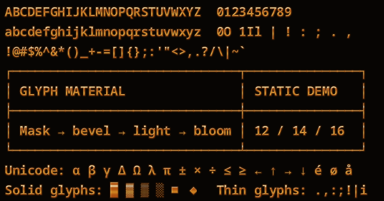

# Bounded 16 pt material refinement — 2026-11-01

**Recommendation: NO-GO for further automatic parameter tuning or full development.
Retain the original default; submit this opt-in candidate for owner comparison.**

16 pt supplies enough area to make a reflection band and opposing bevel facets
more visible on solid blocks and thick stems. In this single bounded candidate,
that does **not** produce a meaningful step toward the approved molten-metal
appearance across ordinary text. The change is modest and often reads as a
brighter upper edge rather than a sculpted metal surface. No second round of
parameter exploration was pursued. This is a result about this candidate, not
proof that 16 pt or Qt can never achieve the design. The owner may prefer its
subtle highlight treatment; that preference would not resolve the original
renderer performance/portability limitations.

## Preservation and matched comparison

The starting reference is the unchanged
[original 16 pt client capture](../evidence/native/16pt-material-client.png).
The pre-change executable was copied before modification, and
[renderer-before.cpp](evidence/renderer-before.cpp) preserves the exact material
source from commit `bce2be8`. [baseline.sha256](evidence/baseline.sha256) records
the original executable/reference hashes. The old parameters remain the default
in the current executable. `--refine-16` explicitly opts into the candidate and
requires `--points 16`; other font sizes and effects-off combinations are rejected
by that experiment flag. No font, weight, hinting, mask, fixture or layout changes.

Both new comparison captures use **Noto Sans Mono DemiBold 16 pt, 1280×900 client
pixels, DPR 1, logical DPI 96, DP-1 at 2560×1440 / 144 Hz**, normal native Wayland
windows, Qt 6.11.2 OpenGL QRhi and the same Clang 20 release build. Edge and glow
intensity stay at 1. Text, revision zero, window position/size and display settings
are identical. No monitor configuration was changed; before/after output JSON
matches exactly. This is a matched DP-1 test, not a new physical 4K benchmark.
The historical reference was captured on HDMI at scale 1; both the preserved
executable's new capture and current original-mode capture are **pixel-for-pixel
identical** to that historical client image, despite the different output.

| Original 16 pt | Refined 16 pt |
| --- | --- |
| [Unedited client capture](evidence/original-current-client.png) | [Unedited client capture](evidence/refined-client.png) |
| [Unedited native window capture](evidence/original-current-native.png) | [Unedited native window capture](evidence/refined-native.png) |

Native images include window decoration/shadow. Client images are direct
QQuickWindow framebuffer captures. None is rescaled, sharpened, recolored or
retouched. The following supplemental crops preserve original pixels exactly:
rectangle `(16,180)-(656,515)`, natural size **640×335**. View at 100% image scale;
browser/application zoom may otherwise scale their presentation.

Original:


Refined:



Compare with the unchanged [approved Molten Amber artwork](../../../Molten%20Fedora%20Terminal%20Glow.png)
and [alternate approved amber concept](../../../ChatGPT%20Image%20Nov%201,%202026,%2004_25_52%20PM-1.png).
Those images remain artistic targets, not evidence of an equivalent physical font scale.

## What changed and what the images show

Only the opt-in glyph RGB material changes, before composition:

- Bevel falloff narrows from 0.65 to 0.48 logical pixels. Opposing mask-derived
  normals separate pale upper-left illumination from copper lower-right shading.
- A narrower pale reflection band is displaced by the bevel normal, instead of
  simply recoloring all strokes. A darker body and warmer lower reflection give
  solid glyphs a more obvious internal surface transition.
- Directional rim falloff changes from 0.24 to 0.32 logical pixels with a stronger
  pale response. This remains coverage-clipped; it does not inflate glyph geometry.
- Exterior halo formula, intensity, radius, glyph alpha and spacing are unchanged.

The block specimen shows the clearest improvement in reflection separation.
Some capitals/digits gain a stronger highlight and dark opposing edge. Lowercase
and punctuation remain recognizable, and restrained glow is retained, but there
is too little interior area on many strokes for the reflection/bevel distinction
to survive clearly. Bright edge pixels sometimes compete with rather than clarify
the metal surface. Small box-join seams remain. There is no new dimensionality
comparable to the approved artwork, and no new UI/chrome treatment.

This is more than a uniform amber palette adjustment computationally; that alone
is not aesthetic success. Readability assessment is inspection of these fixtures,
not a user/accessibility study.

## Validation, reproduction and limits

The existing focused renderer tests remain, with a fixed-16-pt comparison added:
identical cell/line/sprite geometry, identical alpha at every pixel, changed glyph
interiors and unchanged halo RGB away from the one-pixel antialias fringe. The
first version of that last assertion incorrectly treated every quantized-zero
mask pixel as pure halo: downsampling can retain material color there even when
coverage rounds to zero. The corrected check excludes only that boundary fringe;
it still requires exact alpha equality everywhere. The initial failed logs are
preserved, not presented as passes. No rendering parameters changed to address
this test-boundary correction.

Final release and UBSan trap-mode results are in [tests-final.log](evidence/tests-final.log)
and [ubsan-final.log](evidence/ubsan-final.log). The unchanged old tests still
exercise their prior size/DPR matrix; the **new experiment itself is 16 pt only**.
The previous optimized-GCC discrepancy remains unresolved; this uses the already
validated Clang toolchain. No new dependencies/frameworks were introduced.

Each matched native run paints once at idle, with two frameSwapped signals
including capture. Initial cold paint wall time was 1073 ms original and 1079 ms
refined in these individual runs. This is a smoke observation, not a statistically
supported speed comparison or a new 4K performance pass. The old full-surface
upload and cold-cache limitations remain. No new scrolling benchmark was warranted
once the limited visual gain triggered the stop condition.

Using the [existing build instructions](../../../prototypes/qt-molten-amber/README.md):

```sh
QT_QPA_PLATFORM=wayland QT_SCALE_FACTOR=1 XDG_CACHE_HOME=/tmp/phosphor-002/runtime-cache \
  /tmp/phosphor-002/clang-build/phosphor-002 --points 16 --screen DP-1 --width 1280 --height 900
# Same command with --refine-16 enables the candidate.
```

[capture.py](capture.py) reproduces the pair on this machine and refuses to
overwrite existing images. Logs and KWin geometry identify each variant. No
terminal engine, shell, PTY, artwork modification, other theme or unrelated
feature was added. PR #4 stays unmerged. No automatic continuation is recommended.
