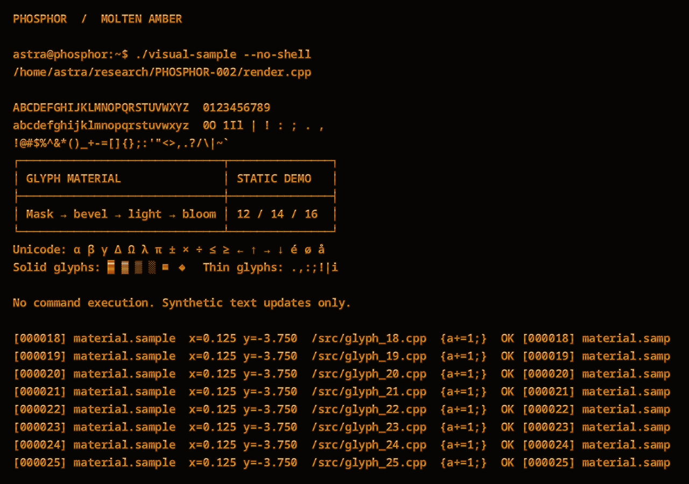
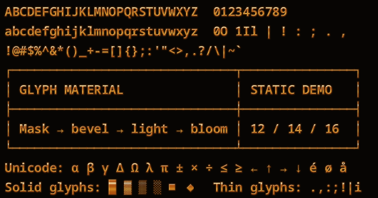

# PHOSPHOR-003 — GPU glyph-atlas performance feasibility

**Recommendation: CONDITIONAL GO for the bounded atlas approach on the tested
Clang / Qt Quick OpenGL / DPR 1 configuration, pending owner visual review.**
The accepted **refined 16 pt Molten Amber** is the baseline to preserve. This
issue does not revisit or override the owner's design preference. No further
visual tuning, full terminal implementation or automatic follow-on issue is
part of this recommendation.

The experiment moves glyph composition to GPU-textured quads while reusing the
accepted material pixels. It removes the whole-window CPU painting and texture
replacement bottleneck under the measured dense-update workload. Cold material
construction remains on the CPU. The previously reported optimized-GCC failure
still reproduces, and physical 4K is unavailable on the DP displays; those limits
must not be hidden behind the warm-cache result. Fractional-scale results are
reported separately below rather than assumed equivalent to DPR 1.

## What changed

The isolated [prototype](../../prototypes/qt-gpu-atlas/README.md) compiles
`qt-molten-amber/renderer.cpp` unchanged. Both selectable paths use Noto Sans Mono
DemiBold at 16 pt, refined material enabled, edge/glow intensity 1, the same
supersampled glyph masks and identical deterministic sample text. Effects-off
uses the same geometry with a constant glyph foreground. There is no shell,
PTY, ANSI parser, other theme, new font, toolbar or custom decoration.

CPU reference: cached glyph sprites → QPainter over the full window → Qt image
texture upload. GPU candidate: the same individual glyph sprites → one resident
RGBA glyph atlas → bounded QSGGeometry triangle lists → GPU sampling/blending.
It is an actual glyph-aware atlas, not an image of a line or screen. Material
shading is **not** recalculated in a GPU shader; the benefit is warm composition
and transfer cost. This was the smallest credible change that preserved the
owner's chosen material without a rewrite. [Phase 0](PHASE0.md) records the
assessment and [BUILD.md](BUILD.md) the public API constraints and reproduction.

At DPR 1 the atlas is 648,000 bytes. It is uploaded once per cache lifetime;
updates and normal resize change geometry only. At most 4,096 glyphs (24,576
vertices) belong to one geometry node, sharing one atlas. This bound avoids the
large-mesh index-range failure observed and corrected during initial validation.
Glyph order is retained so overlapping translucent halos blend consistently.
No hardware draw-call or PCIe-byte count is inferred from node/byte counters.

## Real visual evidence

All `*-client.png` files are unmodified framebuffer grabs from the running
native Qt application. `*-native.png` files are unedited Spectacle captures,
including decorations where applicable. Filename, logs, path choice, geometry
and metrics identify the exact case. These are not generated mockups.

The approved reference is specifically
[PR #4's refined 16 pt capture](../PHOSPHOR-002/refinement-16pt/evidence/refined-client.png),
not the earlier original 16 pt candidate. The original artwork and all prior
research and prototype files remain unchanged. Their hashes/history are audited.

| Accepted refined reference | New CPU reference | GPU atlas |
| --- | --- | --- |
|  |  |  |

Open full PNGs at 100% scale. Supplemental crops below use rectangle
`(16,180)-(656,515)` from the matched 1280×900 captures: **640×335 actual pixels**,
no scaling, retouching, sharpening or color changes. Viewer zoom can still alter
on-screen presentation; original PNG dimensions are authoritative.

CPU:

GPU:

Additional paired captures:

- Effects-off: [CPU](evidence/checks/off-cpu-client.png) / [GPU](evidence/checks/off-gpu-client.png).
- After resize: [CPU](evidence/checks/resize-cpu-client.png) / [GPU](evidence/checks/resize-gpu-client.png).
- 1080p: [CPU](evidence/final-native/1080p-r1-cpu-client.png) / [GPU](evidence/final-native/1080p-r1-gpu-client.png).
- 4K **buffer**, not physical 4K: [CPU](evidence/final-native/4k-buffer-r1-cpu-client.png) / [GPU](evidence/final-native/4k-buffer-r1-gpu-client.png).
- Process-local DPR 1.5: [CPU](evidence/checks/dpr1_5-cpu-client.png) / [GPU](evidence/checks/dpr1_5-gpu-client.png).

### Pixel comparison and scale boundary

At DPR 1, the new 1280×900 CPU reference is pixel-identical to the accepted
refined capture. Refined, effects-off and post-resize CPU/GPU pairs are also
pixel-identical. Visual inspection retains the metallic interior bands, defined
illuminated edges, thin punctuation and restrained glow; owner acceptance is
still required. The fixture text mentioning “12 / 14 / 16” is unchanged sample
content: the actual font is fixed at 16 pt everywhere.

Both 1080p pairs are pixel-identical. Both 4K-buffer pairs differ in 4,534
pixels (0.05466%), each changed channel by at most one 8-bit level. This is
near-identical, not pixel-identical; no duplicate glyph or missing-mesh artifact
remains. The native UBSan 4K capture has the same small difference, and the
threaded-loop 1280×900 GPU capture matches the basic-loop capture exactly.
These comparisons concern captured pixels, not physical 4K readability.

**DPR 1.5 is not accepted as equivalent:** 458,583 of 2,592,000 pixels differ
(17.69%), with a maximum channel delta of 179. Both captures have the same
1280×900 logical / 1920×1350 physical size and fixture. The GPU path snaps
physical glyph positions and samples nearest texels, while the CPU path passes
through QPainter and its scaled image surface. Those differing raster/sampling
paths are a plausible explanation, not a fully isolated cause. The actual
material atlas texels pass equality tests at DPR 1.5; that alone does not prove
final framebuffer equality. Fractional-scale parity needs a separate bounded
placement/sampling investigation before use. No material tuning is attempted
to conceal this discrepancy. This is a NO-GO for claiming fractional-scale
parity, within the overall DPR-1-only CONDITIONAL GO.

## Measured performance

Final dataset: two alternating-order runs per path and resolution, 12 idle and
16 warm-update one-second samples per cell below (112 samples total). The
synthetic update timer requests a revision every 16 ms; it does not guarantee
that cadence. CPU percentage is **one logical core**, not total machine capacity.

| Client buffer / path | Idle CPU % | Dense CPU % | Dense RSS MiB | Warm paint/node work ms per call |
| --- | ---: | ---: | ---: | ---: |
| 1920×1080 CPU | 0.00 | 32.17 | 214.15 | 4.356 |
| 1920×1080 GPU | 0.00 | 2.88 | 180.61 | 0.086 |
| 3840×2160 CPU | 0.67 | 88.65 | 284.06 | 24.521 |
| 3840×2160 GPU | 0.67 | 6.02 | 185.75 | 0.400 |

Warm work is wall time inside CPU painting or scene-graph node update,
excluding cold cache generation. It is not whole-frame time or GPU execution
time. CPU usage drops approximately 91% / 93% in these respective workloads.
The 4K CPU path's ~24.5 ms paint alone exceeds the requested 16 ms cadence;
no invented FPS or key-to-pixel latency is inferred.

Cold cache creation is still 1.08–1.15 seconds across paths; first-frame callbacks
arrive at 1.22–1.29 seconds. Both paths prewarm the same finite repertoire.
This is a fresh process/glyph cache, with reusable driver shader caches, and
**does not demonstrate improved cold-start latency**.

The CPU reference requests a full 8,294,400-byte / 33,177,600-byte image replacement
per update at 1080p / 4K. GPU atlas creation requests 648,000 bytes once and zero
new texture bytes during warm updates. GPU geometry submissions remain 208,512 /
1,184,928 bytes per update. These are application counters, not measured bus
traffic. Glyph material texels and atlas layout are cached; changed text geometry
is rebuilt each update. Persistent geometry updates remain a possible later
optimization, not a prerequisite for this bounded result.

Whole-device GPU utilization during updates averages CPU/GPU 24.94%/23.94% at
1080p and 26.44%/29.31% for the 4K buffer. Whole-device power averages
19.77/18.04 W and 42.07/43.49 W respectively. Other desktop applications share
this GPU; these noisy values establish neither application GPU cost nor an
energy saving. The result is specifically reduced process CPU work and image
replacement, not universally lower GPU utilization or power.

Separate 1280×900 Qt profiling logs show the cold cost inside synchronization:
CPU first sync 1,161 ms, GPU first sync 1,108 ms. Representative subsequent
CPU frames report 2 ms sync, 0 ms render and 1 ms swap; GPU frames report 0 ms
sync/render/swap at the logger's integer-ms precision. These diagnostic examples
are not averages and zero means below logged resolution, not zero work.
They corroborate that the removed warm CPU work sits at the synchronization
boundary; neither log measures GPU completion or isolates driver upload time.
See [CPU profile](evidence/checks/profile-cpu.log) and
[GPU profile](evidence/checks/profile-gpu.log).

Raw [samples](evidence/final-native/samples.csv), per-run JSON/logs and the
[offline aggregation](evidence/analysis.json) retain cold/warm counters and
individual runs. [analyze.py](tools/analyze.py) reproduces tables and image
comparisons; [BUILD.md](BUILD.md) gives timing boundaries and environment.
## Validation and remaining gate

Clang 20 release atlas tests pass (23.50 s). Clang UBSan trap atlas tests pass
(26.26 s), covering exact premultiplied texel copies, transparent guards,
non-flat material interiors and fixture repertoire at DPR 1, 1.5 and 2 with
both effects settings. GCC 16.2.1 release compiles, then fails the material
corner-alpha check (1.55 s); this reproduces the known rectangular halo.
The failure is retained in [gcc-tests.log](evidence/gcc-tests.log), not waived
or asserted to be a proven compiler bug. No accepted material code was changed.

The tested system is Qt 6.11.2, native Wayland/KWin, NVIDIA RTX 3070 Ti with
615.78.08 driver, Qt Quick's OpenGL RHI backend. Public Qt scene-graph APIs are
used; no private API or new dependency/license is introduced. All final timing
runs use the basic render loop. A threaded-loop smoke test is separate from
performance measurements. Native UBSan uses a 4K client to exercise the bounded
geometry batches; driver internals are outside sanitizer coverage.

The initial oversized mesh visibly failed at 4K. It was corrected with bounded
batches and the complete paired dataset was repeated. One early CPU window also
changed size mid-run. Those initial runs remain in `evidence/diagnostic-native`
and are excluded from every final performance table. No failed evidence is
silently replaced. Details and reproduction are in [BUILD.md](BUILD.md).

**CONDITIONAL GO** means the atlas architecture is credible for this bounded,
fixed-font, finite-repertoire experiment. It does not mean the terminal is ready:

- Owner must accept the matched real screenshots; the accepted design is not
  changed by this recommendation.
- Physical 4K remains untested because neither available DP output offers it.
- GCC optimized material rendering remains unsuitable; the demonstrated path
  uses Clang. Resolving it requires separate bounded investigation.
- Cold material creation still blocks the first frame for about a second.
  This experiment proves a warm composition improvement, not startup efficiency.
- General Unicode shaping, fallback fonts, dynamic atlas eviction, context loss,
  other GPUs/backends, sustained thermal behavior and input latency are outside
  this finite deterministic fixture. Atlas reuse across normal resize is tested;
  live cross-monitor DPR migration is not established by process-local scaling.
- The 16 ms update request, two short repetitions and whole-device GPU telemetry
  are limited performance evidence, not a production throughput guarantee.

No artwork or historical evidence is edited. No desktop mode/default is changed,
no packages are installed, and timed sample windows exit automatically. Stop at
the owner-review PR; do not merge, begin terminal development or advance issues.
