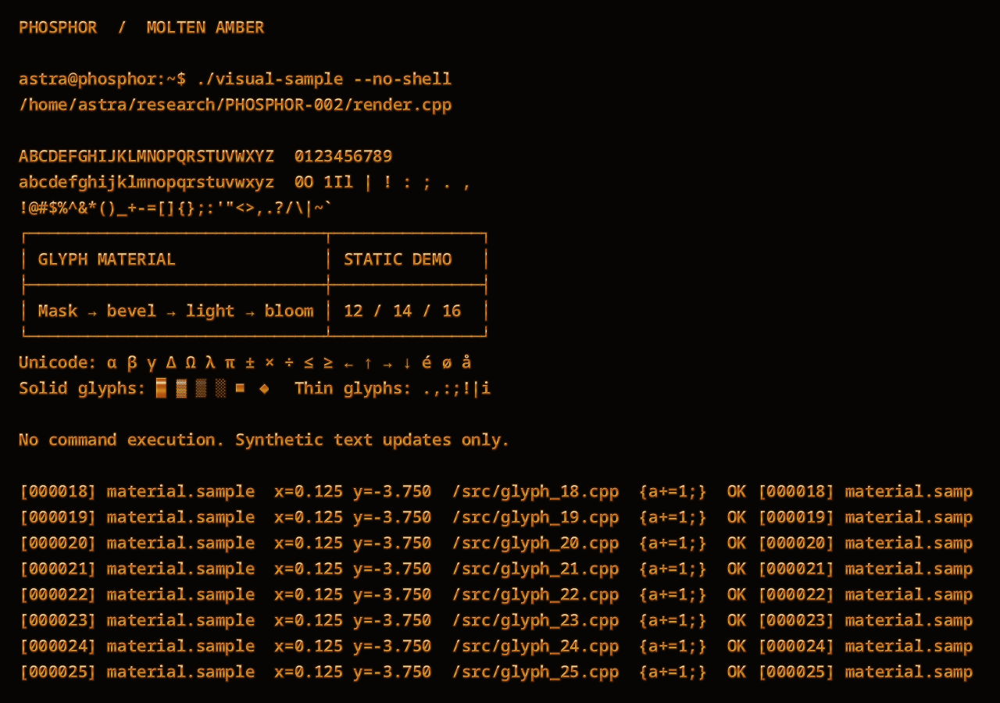
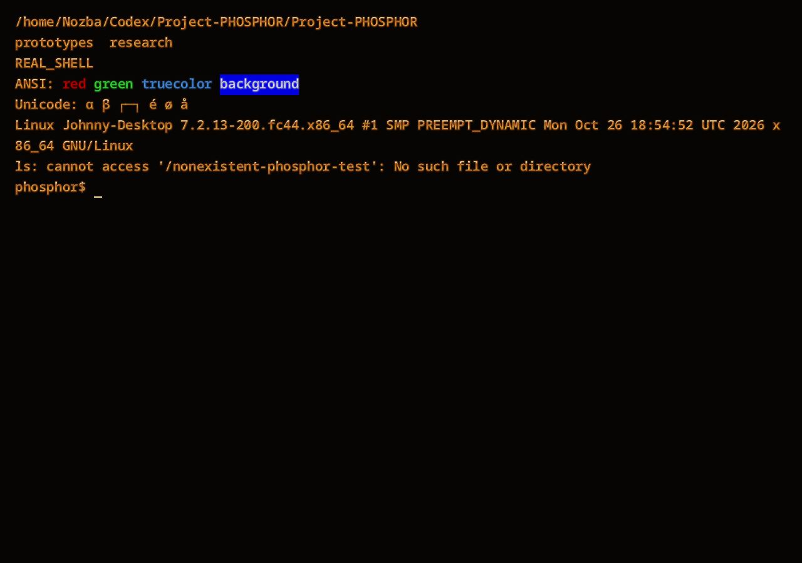
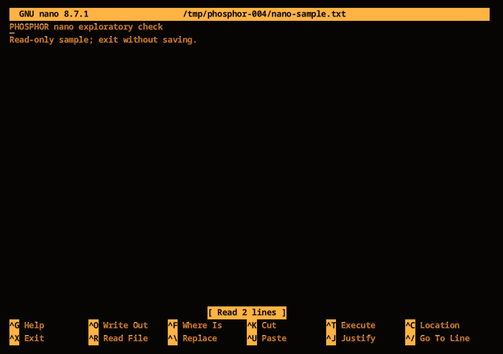

# PHOSPHOR-004 — basic interactive terminal

**Recommendation: CONDITIONAL GO for the basic shell milestone on the tested
Clang / Qt Quick OpenGL / DPR 1 configuration, pending owner interaction review.**
The standalone window runs ordinary commands with the accepted refined 16 pt
Molten Amber material. No full-terminal, production, security-audit or complete
Unicode/VT-conformance claim follows. No subsequent milestone is started.

Issue [#7](https://github.com/mongstad/Project-PHOSPHOR/issues/7) was the single
open issue, marked **Ready / P0** on the project board. Work starts from accepted
`main` commit `2109428` (merged PR #6), on `issue-7-basic-terminal`. All original
artwork, accepted renderer source and PHOSPHOR-001/002/003 evidence are preserved.

## Delivered behavior

A separate [C++20/Qt terminal prototype](../../prototypes/qt-terminal/README.md)
adds an unprivileged Linux PTY bridge and the established MIT-licensed libvterm
screen/keyboard engine. Protocol state, process lifecycle and GPU presentation
remain separate modules. The default launches the account's configured shell;
Bash fallback and a reproducible clean-Bash test mode are available.

The user can type commands and use readline, Ctrl+C/D/L, arrows, Return,
Backspace and Tab. Native resize updates the grid and PTY via TIOCSWINSZ. There
are 1,000 bounded history lines, navigated with Shift+PageUp/Down or the wheel.
Shell exit closes the window; normal window close cleans up the shell and
remaining jobs in its PTY session. No terminal default, shell configuration,
Konsole profile, desktop display mode or package installation is changed.

The GPU path caches individual glyphs in bounded pages and submits ordered
triangles; it does not raster/upload the complete terminal surface. Default
text uses the original accepted RGBA pixels. Explicit ANSI foregrounds tint the
glyph material's intensity; opaque cell backgrounds and a steady underline
cursor are separate geometry. No palette, font, glow or artwork tuning occurs.
The app remains a plain native window, without tabs, custom chrome or settings.

[BUILD.md](BUILD.md) records architecture, dependency/licensing implications,
exact reproduction and diagnostic failures. libvterm is an additional scoped
terminal dependency; Qt ShaderTools/qsb is build-time only. No release is made.

## Actual visual evidence

The matched test writes the exact accepted fixture to a file, then types a
`cat` command in real Bash. Output travels through the PTY and libvterm; it is
not injected into the renderer. The resulting **1280×900 DPR 1 capture is
pixel-identical (zero differing pixels/channels)** to PR #4's accepted refined
16 pt capture. This also verifies shader/default-color preservation across the
new terminal-state path. The fixture's historic “No command execution” line is
literal comparison text, not a description of the new application.

| Accepted refined sample | Same text through real terminal |
| --- | --- |
|  |  |

[Commands, colors and errors](evidence/commands-client.png):

[Nano exploratory capture](evidence/nano-client.png):

All `*-client.png` images are unedited captures from the running Qt window;
`*-native.png` are unedited Spectacle active-window captures with native
chrome. Full images should be opened at 100% scale; no sharpening, compositing
or recoloring is performed. Text/colors in ordinary command/nano/fastfetch
captures naturally differ from the comparison fixture. ANSI backgrounds are
intentional protocol requests, not glow rectangles. New colors are protocol
foregrounds, not new themes. The paired 100%-pixel crops use exactly
`(16,180)-(656,515)` without resampling.

100% crops: [accepted](evidence/accepted-crop-100pct.png) /
[final terminal](evidence/terminal-crop-100pct.png).
Final-build regression: [matched](evidence/final-matched-client.png),
[Tab completion, Backspace, wide backgrounds and new glyphs](evidence/final-keys-client.png),
[UBSan](evidence/final-ubsan-client.png).

Other real captures: [line editing / Ctrl+C](evidence/editing-client.png),
[scrollback](evidence/scrollback-client.png), [resize](evidence/resize-client.png),
[cursor positioning / Ctrl+L](evidence/positioned-client.png),
[fastfetch](evidence/fastfetch-client.png),
[configured shell](evidence/configured-shell-client.png),
[native UBSan run](evidence/ubsan-native-client.png).
Exact commands, timed Qt keyboard actions, text dumps, logs and geometry are
retained alongside every named case. Key automation uses the same Qt handler
as physical keyboard events; physical human typing remains owner review.

## Focused validation

| Check | Executed result |
| --- | --- |
| Clang release build / focused tests | Pass, 0.59 s; parser + Qt key encoding + real PTY integration |
| Clang UBSan trap build / tests | Pass, 0.59 s; includes unmodified libvterm C sources |
| Native UBSan shell/output/resize | Pass, normal exit, no trap |
| Fragmented bytes | Whole-stream and one-byte UTF-8/CSI/OSC/DCS input yield the same screen |
| Screen behavior | Cursor motion, erase, truecolor/basic SGR, reverse/conceal, alternate screen, bounded history and resize assertions pass |
| PTY lifecycle | Exec failure, initial/changed stty size, foreground interrupt, status 7 exit/reaping and HUP-resistant background-job close and EOF-with-live-child tests pass |
| Ordinary commands | `pwd`, `ls`, `echo`, `printf`, `uname -a`, error output and 1,200-line `seq` pass in real native window |
| Keyboard | Actual readline insertion produces `hello`; Ctrl+C interrupts `sleep 30`, Ctrl+L redraws, Ctrl+D exits; encoder checks Return/Backspace/Tab/application-cursor mode |
| Resize | 800×600 produces `stty size` = `16 59`, then returns to 1280×900 |
| History | 1,200 lines retain at most 1,000; Shift+PageUp shows older lines, navigation returns live |
| nano 8.7.1 | Opens sample file with cursor/status/help bars, exits via Ctrl+X without saving; exploratory only |
| fastfetch | Installed command runs with `--logo none`; native capture retained |
| htop | Not installed; not tested |
| Configured shell | Account `/bin/bash -i` starts normally, executes inspection commands and exits |
| Accepted appearance | Matched full client image is exactly equal at DPR 1, including final-build regression |
| Previous GCC / fractional scale issues | Retained unresolved; no new equivalence or compiler-fix claim |

The initial shader setup failed to render glyphs and is retained as `pilot-*`.
A corrected batchable QSB shader plus explicit texture upload commit resolved
that failure. Test-development failures and their raw Ctrl+C transcript remain
in the build logs. These are excluded from accepted evidence, not hidden.

## Performance

Physical DP-2 **1920×1080 at DPR 1**, Qt 6.11.2 OpenGL RHI, NVIDIA RTX 3070 Ti,
driver 615.78.08, native KDE/Wayland. Two runs per application, ten one-second
idle and twelve output samples per application (44 total). CPU is percent of
**one logical core**, excluding Bash/Python child CPU. GPU/power is whole-device
telemetry shared with other desktop applications.

| Path / workload | Process CPU % | RSS MiB | Whole GPU % | Whole GPU W |
| --- | ---: | ---: | ---: | ---: |
| Interactive terminal idle | 0.10 | 149.51 | 20.10 | 32.10 |
| Interactive terminal continuous PTY output | 5.57 | 184.62 | 31.42 | 20.40 |
| Accepted GPU fixture idle | 0.00 | 149.88 | 26.70 | 28.08 |
| Accepted GPU fixture synthetic updates | 3.31 | 176.38 | 30.25 | 20.22 |

The terminal producer requests twenty 140-column lines every 16 ms, through the
PTY, parser, scrolling and rendering. The fixture only revises deterministic
text every 16 ms, with no shell or parsing. The fixture is a contextual baseline;
**these are not identical workloads and no direct speedup/regression percentage
is claimed**. Whole-device power differs substantially even at idle; it cannot
be attributed solely to this application.

Each eight-second warm snapshot interval receives 1,411,480 bytes (~176 KB/s),
with parser wall time 73.32 / 73.02 ms and render-node work 215.40 / 216.60 ms
across 249 calls. Mean node work is about 0.87 ms per call. Redraw coalescing
reduces calls relative to producer batches; these counters are not presentation
FPS, latency or GPU execution timings. Texture replacement during both intervals
is **zero bytes**. Cold cached pages request 1,152,000 bytes (two pages); the
512-glyph ceiling is four pages. Normal resize reuses glyph pages. First-frame
callbacks in the native checks arrive around 1.1–1.2 seconds, still dominated
by the accepted CPU material construction.

The final timing dataset predates only the focused EOF-with-live-child and
wide-continuation-background fixes plus formatting; those paths are not exercised
by the ASCII producer. Final Clang/UBSan tests and native pixel/keyboard checks
cover those fixes. No performance improvement from them is asserted.

[Raw samples](evidence/performance-final/samples.csv), per-run logs/JSON and
[offline analysis](evidence/analysis.json) preserve timing boundaries and actual
sizes. [measure.py](tools/measure.py) reproduces the bounded workload. No physical
4K or new 4K-buffer performance claim is made in this milestone.

Earlier runs in
`evidence/performance/` included a fixture screenshot during idle and are
retained as diagnostics only; final tables use `evidence/performance-final/`.

## Remaining limits and owner gate

The bounded interactive shell is usable in the executed cases, but several
material limits make **CONDITIONAL GO** more accurate than a full GO:

- Refined visual acceptance is demonstrated only at DPR 1 on this Clang/Qt/NVIDIA
  OpenGL setup. The accepted GCC and fractional-DPR limitations remain. There
  was no physical 4K display on DP and no new 4K measurement for this issue.
- Single-cell BMP glyphs and NFC-composable accents are supported visually.
  Wide/non-BMP/emoji and unresolved combining clusters show a replacement while
  preserving cell advance. Atlas capacity is 512 glyphs; cold/missing glyph
  construction still costs CPU time and may briefly show replacements. This is
  not full Unicode shaping or a universal terminal font implementation.
- Terminal protocol behavior uses libvterm, but only the listed subset and
  exploratory nano session are validated. TERM compatibility does not establish
  complete xterm/TUI support. Italic/blink/double-size text, requested cursor
  shape/blink, IME, mouse reporting and clipboard/selection UI are deferred.
- Resize does not reflow history. History is bounded to 1,000 lines and excluded
  from alternate-screen navigation. Application-requested erase-history is honored.
- Normal close owns and terminates its PTY session, including background job
  groups. Deliberately detached/new-session processes are outside ownership;
  forced app termination/crashes are not a shutdown-cleanup guarantee.
- Cold startup remains about one second. New glyph pages upload when populated;
  warm output reuses them. Short performance samples are not latency, sustained
  thermal, accessibility, security or production-readiness certification.

Owner should review actual typing/readability and these explicitly bounded
behaviors before merging. No full product, extra theme, packaging, release,
merge or subsequent issue work is included.
